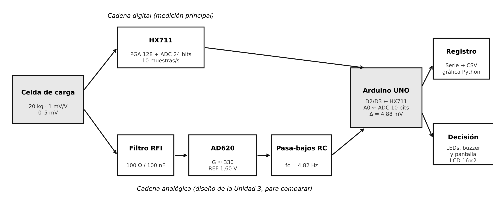
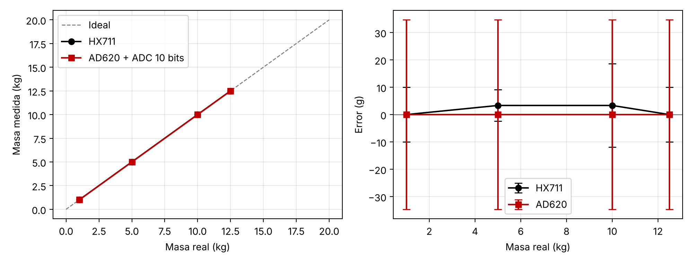
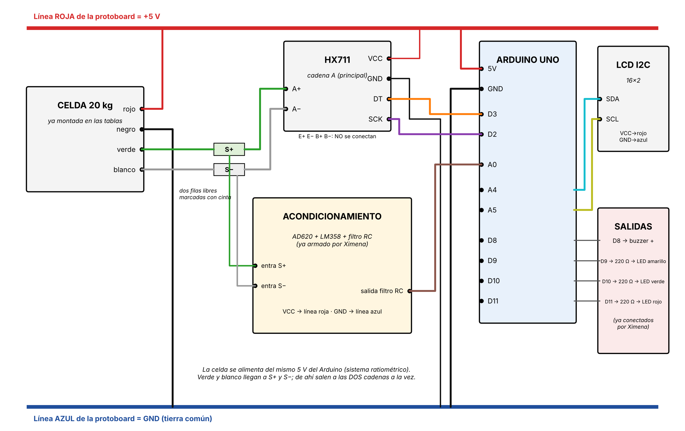

# Báscula digital de arrobas para café (0–20 kg)

Báscula con celda de carga y Arduino UNO para pesar café por arrobas (12,5 kg). La señal de la celda se lee por **dos cadenas en paralelo**: un módulo **HX711** (24 bits), y una cadena analógica diseñada desde cero con un **AD620**, una referencia con **LM358** y un **filtro RC**. Muestra el peso en una LCD, guarda cada pesada en CSV y avisa con LEDs y buzzer cuando el bulto completa la arroba.

Proyecto integrador de **Sensórica para Ingenierías**, Ingeniería Electrónica, Universidad Surcolombiana (Neiva), 2026-2.

**Equipo:** Sebastián Serrato Ramírez · Ximena del Rocío Moreno · Jhoan Sebastián Quiza Durán



## ¿Por qué dos cadenas?

El HX711 amplifica, filtra y convierte por dentro, como una caja cerrada. Para diseñar nosotros el acondicionamiento hicimos una segunda cadena analógica y la comparamos con el módulo comercial, midiendo el mismo peso en el mismo instante.

| Etapa | Cadena A: HX711 | Cadena B: diseño propio |
|---|---|---|
| Amplificación | PGA interno, G = 128 | AD620, G = 1 + 49,4 kΩ / 150 Ω ≈ 330 |
| Referencia | — | 1,60 V (divisor 10 kΩ / 4,7 kΩ + seguidor LM358) |
| Filtrado | Filtro digital, 10 SPS | RFI de entrada + RC 10 kΩ / 3,3 µF (f_c = 4,82 Hz, −22 dB a 60 Hz) |
| Conversión | Σ-Δ de 24 bits | ADC de 10 bits: Δ = 4,88 mV ≈ 59 g por cuenta |
| Muestreo | 10 lecturas/s | 600 Hz, promedio de 60 → 10 lecturas/s |

## Resultados

Verificación con masas conocidas, tres repeticiones por masa ([datos](datos/verificacion_masas.csv)):

| Masa real | HX711 (promedio) | AD620 (promedio) | Desv. estándar HX711 / AD620 |
|---|---|---|---|
| 1 kg | 1,000 kg | 1,00 kg | 10 g / 35 g |
| 5 kg | 5,003 kg | 5,00 kg | 6 g / 35 g |
| 10 kg | 10,003 kg | 10,00 kg | 15 g / 35 g |
| 12,5 kg | 12,500 kg | 12,50 kg | 10 g / 35 g |

- **HX711:** todas las lecturas quedan dentro de ±20 g. La meta era ±50 g.
- **AD620:** acierta en promedio, pero sus lecturas saltan de a 0,06 kg, una cuenta del ADC de 10 bits, como se calculó en el diseño.
- **Salida del AD620 medida en A0:** 1,58 / 2,02 / 2,60 V con 0 / 5 / 12,5 kg. Los valores de diseño eran 1,60 / 2,01 / 2,63 V.



## Decisión automática

| Estado | Condición | Salida |
|---|---|---|
| Llenando | m < 12,4 kg | LED amarillo, LCD «Falta x kg» |
| Arroba lista | 12,4–12,6 kg | LED verde y un pitido |
| Pasado | m > 12,6 kg | LED amarillo, LCD «Sobra x kg» |
| Sobrecarga | m > 20 kg | LED rojo y buzzer intermitente |

Tiene una histéresis de 0,05 kg para que la alarma no parpadee justo en el límite.

## Contenido del repositorio

```
codigo/bascula_arrobas/   Programa principal (Arduino UNO)
codigo/prueba_salidas/    Prueba de LCD, LEDs y buzzer sin la celda
codigo/registrar.py       Registro en CSV y gráfica en tiempo real (Python)
simulacion/               Versión para Wokwi (un potenciómetro reemplaza al AD620)
datos/                    Mediciones de la verificación
docs/Informe_tecnico.pdf  Informe completo: diseño, cálculos, resultados y referencias
docs/img/                 Diagrama de bloques, esquema de conexiones y gráficas
```

## Cómo usarlo

1. En Arduino IDE instala las librerías **HX711** (Bogdan Necula) y **LiquidCrystal I2C** (Frank de Brabander).
2. Conecta todo según el [esquema](docs/img/esquema_conexiones.png) y sube `codigo/bascula_arrobas/bascula_arrobas.ino`.
3. Abre el monitor serie a 115 200 baudios:
   - `t` hace la tara con la báscula vacía.
   - `c5.0` calibra con una masa conocida de 5,0 kg.
4. Para registrar y graficar:
   ```
   pip install pyserial matplotlib
   python codigo/registrar.py COM5
   ```



## Materiales

Arduino UNO, celda de carga tipo barra 20 kg (1 mV/V, 4 hilos), módulo HX711, AD620, LM358, LCD 16×2 con I2C, LEDs, buzzer activo, resistencias y condensadores (lista completa en el informe), y una plataforma de dos tableros MDF de 20 × 20 cm.

## Limitaciones

- La cadena B está limitada por el ADC de 10 bits. Con un ADS1115 de 16 bits bajaría a ≈ 1,5 g por cuenta.
- Las masas de prueba se verificaron en una báscula comercial, no con pesas certificadas.
- Es un prototipo académico: una báscula para compraventa en Colombia requiere verificación de metrología legal.

## Licencia

MIT. Ver [LICENSE](LICENSE).
